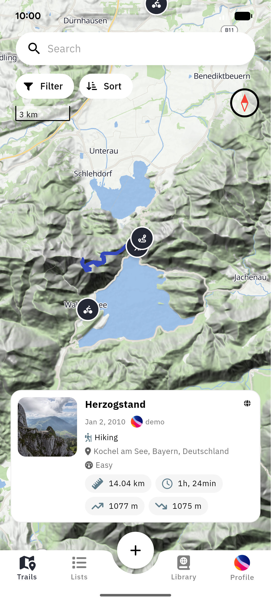
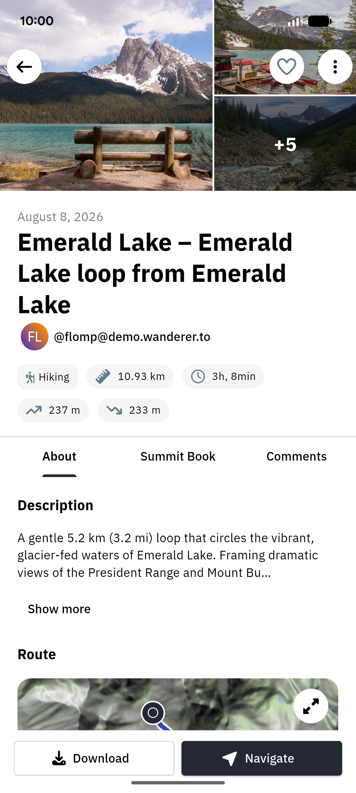
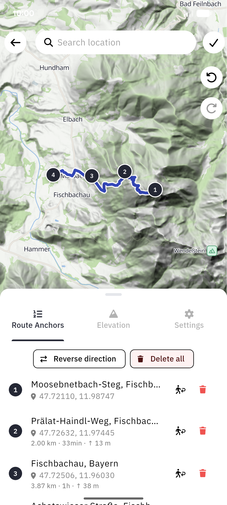
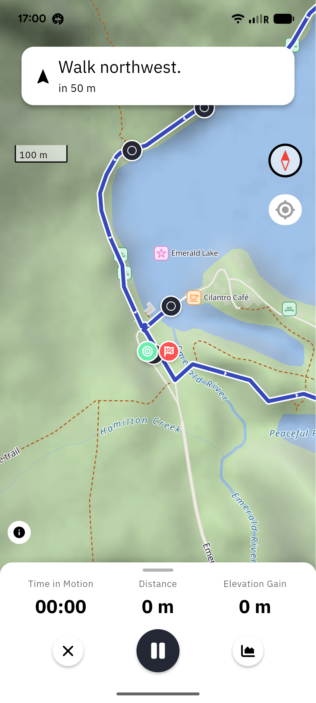
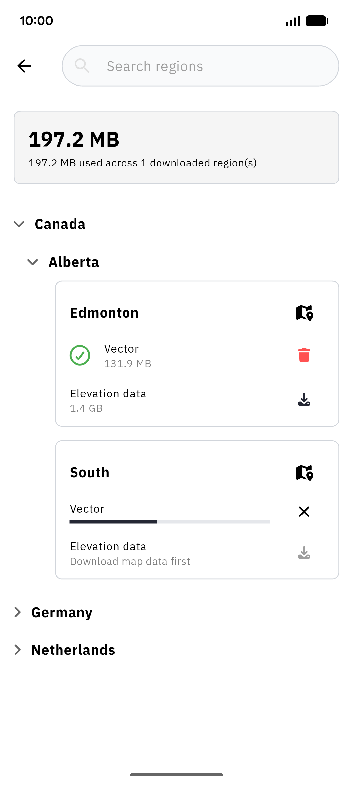
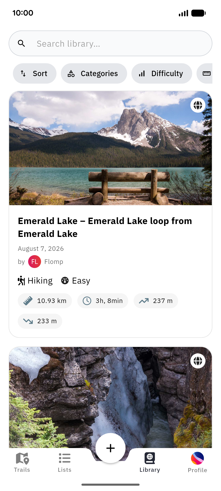

<p align="center">
  
</p>

# wanderer mobile app

The Android and iOS app for [wanderer](https://wanderer.to), the self-hosted trail database. It connects to any wanderer instance and brings the parts of wanderer that matter on the trail to your phone: browsing and searching trails, recording hikes with GPS, planning routes, turn-by-turn navigation, and whole map regions for offline use.

The app is in public beta. To install it, see [wanderer.to/app](https://wanderer.to/app#install) (TestFlight on iOS, the Google Play open test or an APK on Android). User documentation lives under [App](https://wanderer.to/app/getting-started) in the docs; [What works where](https://wanderer.to/app/what-works-where) lists which features are in the app so far and which are still web-only.

| Find trails | Trail details | Plan a route | Navigate |
| :-: | :-: | :-: | :-: |
|  |  |  |  |

This README is for people working on the app itself.

- [Requirements](#requirements)
- [Getting started](#getting-started)
- [Connecting to a backend](#connecting-to-a-backend)
- [Code generation](#code-generation)
- [Localization](#localization)
- [Testing](#testing)
- [Project layout](#project-layout)
- [Architecture notes](#architecture-notes)
- [Platform notes](#platform-notes)
- [Contributing](#contributing)

## Requirements

| | Version |
| --- | --- |
| Flutter | 3.47 or newer, stable channel (CI pins `3.47.8`) |
| Dart | `^3.13.0` |
| Android | `minSdk` 26 (Android 8.0), `compileSdk` 37, JDK 17 |
| iOS | 15.0 or newer, Xcode with CocoaPods |
| wanderer server | 0.21.2 or newer, with NodeInfo (see below) |

The app refuses servers it cannot talk to. On instance selection it reads the server's NodeInfo 2.1 document and compares `software.version` against `kMinimumServerVersion` in [`lib/util/server_compatibility.dart`](lib/util/server_compatibility.dart). A server without NodeInfo is too old regardless of its version; NodeInfo ships with the `-app` Docker images and every release from v0.22.0. An incompatible server shows **Server not supported** and keeps login and registration disabled. Raise `kMinimumServerVersion` whenever the app starts depending on a newer backend endpoint.

Administrators find the server-side setup in [Mobile app support](https://wanderer.to/run/backend-configuration/mobile-app).

## Getting started

```bash
cd app
flutter doctor
flutter pub get
flutter run
```

Generated code is committed, so a fresh clone runs without a `build_runner` pass. You only need one after changing an annotated class (see [Code generation](#code-generation)).

## Connecting to a backend

On first launch the app asks for an instance. You can pick a public one or enter any URL, including a local development server. For a local backend, follow the [local development guide](https://wanderer.to/develop/local-development) and keep these points in mind:

- **Point the app at SvelteKit, not PocketBase.** The app talks to the web frontend, which proxies to PocketBase: port `5173` for `npm run dev`, `3000` for a production build. Never `8090`.
- **Plain HTTP only works on loopback.** The app allows `http://` only to `127.0.0.1` (iOS also accepts `localhost`). LAN addresses and the emulator bridge `10.0.2.2` are blocked on both platforms.
  - Android emulator or USB device: run `adb reverse tcp:5173 tcp:5173`, then enter `http://127.0.0.1:5173`.
  - iOS simulator: shares the host network, so enter `http://127.0.0.1:5173` directly.
  - Physical device without USB: expose the dev server over HTTPS (reverse proxy or tunnel).
- **`ORIGIN` must match the URL you enter.** After sign-in the app stores the server address derived from your user's ActivityPub actor IRI, which the backend builds from `ORIGIN`. If the two differ (`localhost` vs `127.0.0.1`, for example) the first sign-in works but the session is lost on the next restart. Set `export ORIGIN=http://127.0.0.1:5173` before starting the backend. Users created under an old `ORIGIN` keep their old IRI; create a fresh user rather than changing `ORIGIN` after the fact.

Self-hosted instances behind a private root CA work on Android as long as the CA is installed as a user certificate: [`lib/services/user_ca_trust.dart`](lib/services/user_ca_trust.dart) loads user CAs into `dart:io` at launch. A CA installed while the app runs only takes effect after a restart.

## Code generation

The app uses generated code for:

- immutable models ([freezed](https://pub.dev/packages/freezed)) and JSON serialization ([json_serializable](https://pub.dev/packages/json_serializable)),
- [Riverpod](https://riverpod.dev) providers (`riverpod_generator`),
- the [ObjectBox](https://objectbox.io) local database (`objectbox_generator`).

After changing any annotated class, regenerate:

```bash
dart run build_runner build --delete-conflicting-outputs
```

Commit the generated `*.g.dart` and `*.freezed.dart` files together with the change. This applies especially to [`lib/objectbox-model.json`](lib/objectbox-model.json) and `lib/objectbox.g.dart`: the model file records the entity and property IDs that existing on-device databases rely on, so it must never be regenerated from scratch or edited by hand. Renaming or removing an entity field changes the on-device schema; check how existing installs migrate before you ship it.

## Localization

User-facing strings live in ARB files in [`lib/i18n/`](lib/i18n/), with `app_en.arb` as the template. Translations are managed through Crowdin; only edit `app_en.arb` by hand.

`flutter run` and `flutter build` regenerate the localization classes automatically (`generate: true`). To regenerate them explicitly after adding a string:

```bash
flutter gen-l10n
```

This also refreshes [`lib/i18n/untranslated_messages.json`](lib/i18n/untranslated_messages.json), a committed report of strings that are still English-only in other locales. Commit it with your change, so a growing gap shows up in the diff.

When Crowdin syncs, check the `@@locale` value of each ARB file: Crowdin writes regional codes (`es-ES`, `pt-PT`, `zh-CN`) that `gen-l10n` rejects. Reset them to the bare language code (`es`, `pt`, `zh`).

## Testing

```bash
flutter analyze --no-fatal-infos
flutter test
```

These are the two checks CI runs on every push and pull request that touches `app/`, so run them before you open a PR.

The tests under [`test/`](test/) mirror the `lib/` layout. A few points worth knowing:

- **GPX metrics corpus.** [`test/util/gpx/corpus_test.dart`](test/util/gpx/corpus_test.dart) reads [`../fixtures/gpx-corpus`](../fixtures/gpx-corpus) from the repository root. The web app runs the same corpus through its TypeScript implementation, which pins both to identical distance and elevation results. Run `flutter test` from `app/` so the relative path resolves. If you change how a trail's metrics are computed, change both implementations and the corpus together; see the corpus [README](../fixtures/gpx-corpus/README.md).
- **Harnesses.** Files ending in `_harness.dart` in `test/services/` are test helpers, not tests.
- **Real devices.** Recording, background location, notifications and offline tiles depend on platform behaviour that unit tests cannot cover. Changes in those areas need a check on a physical device.

## Project layout

```
app/
├── lib/
│   ├── main.dart          Startup: CA trust, ObjectBox, tile proxy, cookie jar, ProviderScope
│   ├── routes/            One file per screen; wired up in provider/router_provider.dart
│   ├── components/        Reusable widgets, grouped by feature (trail/, map/, route_planner/, ...)
│   ├── provider/          Riverpod providers: API access, app state, settings
│   ├── actions/           Multi-step flows shared between screens (import a file, launch navigation, ...)
│   ├── models/            Immutable API models (freezed)
│   ├── entities/          ObjectBox entities: offline trails, regions, settings, navigation state
│   ├── store/             The read/write layer over local entities (local trails, photos, search history)
│   ├── services/          Long-running services: tile proxy, downloads, position source, shortcuts
│   ├── util/              Pure helpers: geo maths, GPX parsing, route and region logic
│   ├── theme/             Colours, typography, theme data
│   ├── i18n/              ARB files and generated localizations
│   └── vendor/gpx/        Vendored tolerant GPX reader
├── vendor/tiptap_flutter/ Vendored rich-text editor package (path dependency)
├── assets/                Map styles, SVGs, fonts (IBM Plex Sans, Noto Sans)
├── test/                  Unit and widget tests, mirroring lib/
├── android/
└── ios/
```

## Architecture notes

**State and navigation.** State lives in Riverpod providers (code-generated with `@riverpod`), navigation in [go_router](https://pub.dev/packages/go_router) ([`lib/provider/router_provider.dart`](lib/provider/router_provider.dart)). The app shell has four tabs (Trails, Lists, Library, Profile) plus a central action button for creating trails. `main.dart` installs a global provider retry policy of at most two retries, so a provider failing while offline doesn't wake the radio over and over. Override it per provider with `@Riverpod(retry: ...)` where needed.

**Networking.** All API calls go through Dio with a persistent cookie jar, against the SvelteKit `/api/v1` routes of the selected instance. Login supports username and password as well as the OAuth2 providers the instance has configured, which return to the app through the `wanderer://` URL scheme.

**Local data and offline trails.** ObjectBox is the on-device database. Downloaded trails and trails captured on the device (recorded, planned or imported but not uploaded yet) live in the same `TrailEntity` box and are told apart by `owner`, `localId` and `syncState`. [`lib/store/local_trail_store.dart`](lib/store/local_trail_store.dart) is the only sanctioned way to read and write them. Unsynced trails are uploaded by [`trail_sync_provider.dart`](lib/provider/trail/trail_sync_provider.dart) on cold start, on returning to the foreground and when connectivity comes back.

**Accounts.** One device can sign in to several accounts and instances over time. Local data is scoped to the signed-in account by filtering; switching accounts must never delete another account's downloaded trails or regions. Downloaded map regions and the shared map cache are deliberately not tied to any account.

**Maps and offline regions.** Maps render with [MapLibre](https://pub.dev/packages/maplibre). [`TileProxyServer`](lib/services/tile_proxy_server.dart) is a loopback-only HTTP server started in `main.dart`. It serves vector and hillshade tiles from downloaded region `.pmtiles` archives, plus glyphs and sprites from a shared cache. Tiles a downloaded region doesn't cover are redirected to the upstream tile source, not proxied, so heavy panning stays off the main isolate. `main.dart` also raises MapLibre's ambient tile cache to 512 MB, which is the main lever on mobile data use.

| Offline regions | Library |
| :-: | :-: |
|  |  |

**Recording and navigation.** GPS recording uses [tracelet](https://pub.dev/packages/tracelet) through [`TraceletPositionSource`](lib/services/tracelet_position_source.dart), which runs as a foreground service on Android and in the `location` background mode on iOS. Distance comes from the raw track; elevation gain applies a vertical threshold. These choices are pinned by the GPX corpus shared with the web app, so change them only together with it.

**Incoming content.** The app accepts GPX, KML and KMZ files shared from other apps or opened from a file manager, and offers home-screen quick actions ([`lib/services/app_shortcuts.dart`](lib/services/app_shortcuts.dart)).

## Platform notes

### Android

- Application ID: `com.openwanderer.wanderer`.
- Release signing reads `android/key.properties` (`storeFile`, `storePassword`, `keyPassword`, `keyAlias`; `storeFile` is relative to `android/app`). Without the file, release builds fall back to the debug key, so `flutter build apk --release` works locally without credentials. Never commit the keystore or `key.properties`.
- Recording needs fine and background location, foreground service (location type), notifications and activity recognition. The app asks for background location separately ([`lib/actions/request_background_location.dart`](lib/actions/request_background_location.dart)).
- The manifest declares package-visibility queries for `geo:` and `https:` so "open directions" can find installed map apps.

### iOS

- Open `ios/Runner.xcworkspace`, not the `.xcodeproj`.
- Running on a physical device needs an Apple development certificate; the simulator needs none.
- Location runs in the `location` background mode. `ios/ExportOptions.plist` configures App Store export for CI.
- A share extension for receiving trail files is prepared under `ios/Share Extension/` but not wired into the Xcode project yet. Setting it up requires an App Group, and with it a paid Apple Developer account. The steps are in [`ios/SHARE_EXTENSION_SETUP.md`](ios/SHARE_EXTENSION_SETUP.md).

## Contributing

General guidelines are in the repository's [CONTRIBUTING.md](../CONTRIBUTING.md). For the app in particular:

- Open pull requests against `dev`.
- CI (the **App** workflow) runs `flutter analyze` and `flutter test` on every change under `app/`.
- Report app bugs with the **App bug report** issue template. It asks for the platform, device, app version and your instance's wanderer version.
- Keep generated files, `objectbox-model.json` and `untranslated_messages.json` in sync with the source changes that produce them.
