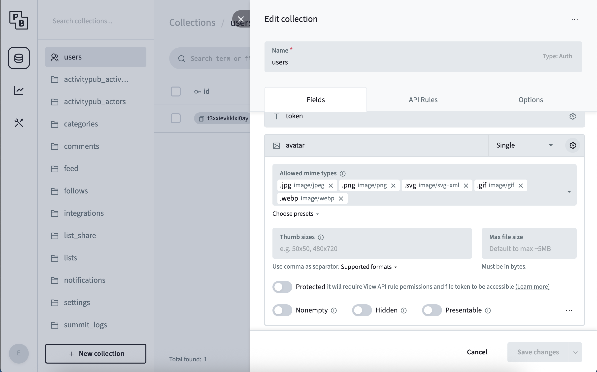

import { Aside } from '@astrojs/starlight/components';

<span class="-tracking-[0.075em]">wanderer</span> brings several mechanisms which allow limiting the maximum file size of content provided by users.
Pictures in the users profile, trail highlights and gpx tracks fall under this file size limit.

<Aside> 
As <span class="-tracking-[0.075em]">wanderer</span> runs parts of the logic in the users browser those limits can only be enforced, when trying to save a ressource.
This can lead to non-intuitive errors such as: editing and creating a trail, which is too large, is possible - saving it is not.
</Aside>

### Body Size Limit

The `BODY_SIZE_LIMIT` setting controls both the frontend adapter's request ceiling and the multipart upload limit. The provided Docker Compose configuration defaults to `2G`, which accommodates 99 photos at the default 20 MiB field limit, a GPX file and multipart headers in one request. The provided image and `npm start` launch the web server through `server.js`, which uses `2G` when the variable is unset. An invalid value logs a warning and also uses `2G` at this startup step. Set `Infinity` to allow uploads of any size by signed-in users, as in previous Compose configurations.
Upload routes authenticate before reading or parsing multipart bodies. Other route limits remain fixed: login 64 KiB, ActivityPub inbox 2 MiB and ordinary requests 1 MiB.

When raising the backend file limits, set the single `BODY_SIZE_LIMIT` [Environment Variable](../../environment-configuration.md) high enough for all files in a request plus multipart headers. For Docker Compose, set it in the `.env` file beside `docker-compose.yml`; source deployments can export it before starting the web server. Check the reverse proxy's request limit as well.

```sh
BODY_SIZE_LIMIT=3G
```

<Aside type="tip">Read more about the limitations and configuration possibilities on the [SvelteKit Reference](https://svelte.dev/docs/kit/adapter-node#Environment-variables-BODY_SIZE_LIMIT).</Aside>

### Backend Filesize Verification

After the file passes the middleware, PocketBase does an additional verification on the file uploaded.
This verification includes a check for a maximum file size.

If this verification does not pass the request is terminated with a `500: error validation_file_size_limit`



To change this behaviour open the PocketBase admin panel and navigate to the designated table.
Click the gear icon at the top to open the table's settings and select the gear icon in the row you want to change.
Adjust the `Max File Size` property.

<Aside>
The maximum file size has to be specified in bytes. The theoretical maximum of a single file attachment is ~8GB as specified by the [pocketbase documentation](https://pocketbase.io/docs/files-handling/)
</Aside>
