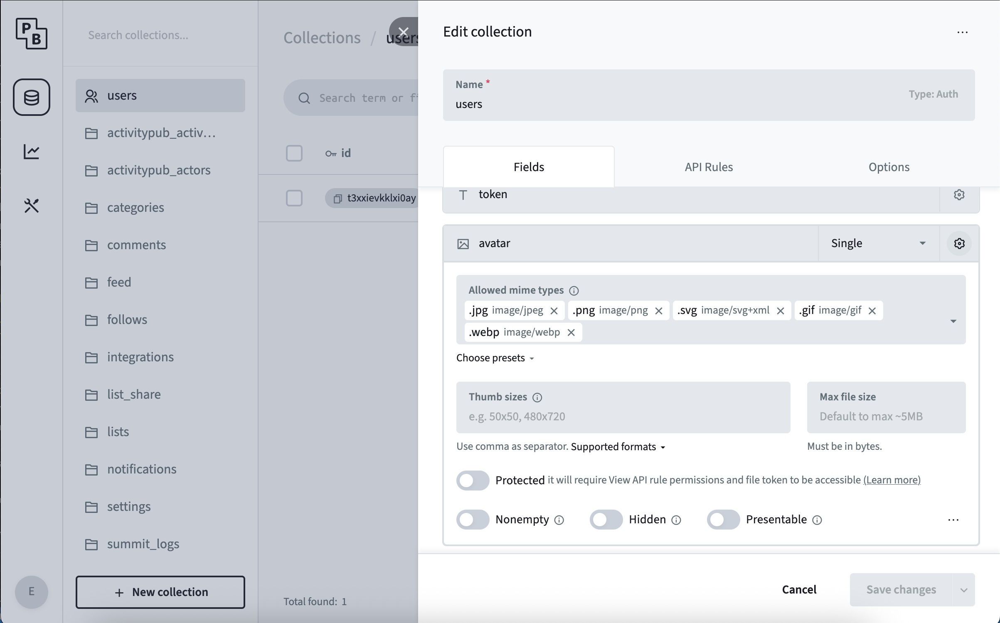

import { Aside } from '@astrojs/starlight/components';

<span class="-tracking-[0.075em]">wanderer</span> brings several mechanisms which allow limiting the maximum file size of content provided by users.
Pictures in the users profile, trail highlights and gpx tracks fall under this file size limit.

<Aside> 
As <span class="-tracking-[0.075em]">wanderer</span> runs parts of the logic in the users browser those limits can only be enforced, when trying to save a ressource.
This can lead to non-intuitive errors such as: editing and creating a trail, which is too large, is possible - saving it is not.
</Aside>

### Body Size Limit

The `BODY_SIZE_LIMIT` setting controls the frontend adapter's request ceiling and the other multipart upload limits. The supplied image and Docker Compose configuration default to `1G`. Bare `server.js` / `npm start` uses the inherited `2G` fallback when the variable is unset or invalid; invalid values also produce a warning. Source deployments can export `BODY_SIZE_LIMIT=1G` explicitly.

Photo and video uploads use the `file` field of the `assets` collection, which accepts up to 50 MiB per file by default. `PUT /api/v1/assets` also has a fixed 1 GiB aggregate limit per request, including multipart framing. Raising the collection file limit or `BODY_SIZE_LIMIT`, even to `Infinity`, does not raise that request limit. Split larger selections into separate requests.

Upload routes authenticate before reading or parsing multipart bodies. Other fixed route limits remain login 64 KiB, ActivityPub inbox 2 MiB and ordinary requests 1 MiB.

Track files sent to `/api/v1/trail/upload` and `/api/v1/trail/convert` are limited by the `Max File Size` of the `gpx` field of the `trails` collection, which is 25 MiB by default, and `BODY_SIZE_LIMIT` still caps them. A change to the field applies within a minute, without a restart. The web server parses these files in memory, and its other parsing limits grow with the field. On a server with little memory, a large value lets one upload exhaust it.

When raising backend file limits for other upload routes, set `BODY_SIZE_LIMIT` [Environment Variable](../../environment-configuration.md) high enough for the request plus multipart framing. Configure it in the Compose `.env` file or export it for source deployments. For asset requests, the fixed 1 GiB ceiling still applies. Check the reverse proxy's request limit as well.

```sh
BODY_SIZE_LIMIT=1G
```

<Aside type="tip">Read more about the limitations and configuration possibilities on the [SvelteKit Reference](https://svelte.dev/docs/kit/adapter-node#Environment-variables-BODY_SIZE_LIMIT).</Aside>

### Backend Filesize Verification

After the file passes the middleware, PocketBase does an additional verification on the file uploaded.
This verification includes a check for a maximum file size.

If this verification does not pass the request is terminated with a `500: error validation_file_size_limit`



To change this behaviour open the PocketBase admin panel and navigate to the designated table.
Click the gear icon at the top to open the table's settings and select the gear icon in the row you want to change.
Adjust the `Max File Size` property.

<Aside>
The maximum file size has to be specified in bytes. The theoretical maximum of a single file attachment is ~8GB as specified by the [pocketbase documentation](https://pocketbase.io/docs/files-handling/)
</Aside>
