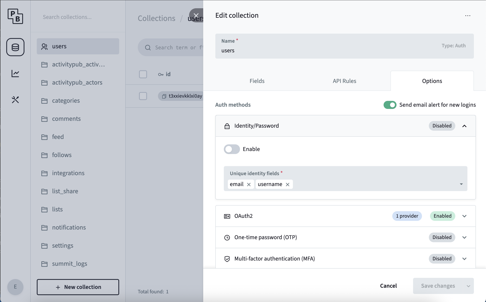

### Create an OAuth app

This step will vary wildly from provider to provider. Please refer to your provider's documentation for the specific steps.

No matter your provider, you will need a redirect URL. This redirect URL must have the following format: `$ORIGIN/login/redirect`. 
`$ORIGIN` refers to the `ORIGIN` environment variable that defines the public host at which your <span class="-tracking-[0.075em]">wanderer</span> instance can be reached. 
So for the default installation, the redirect URL is `http://localhost:3000/login/redirect`.

In any case, once you have successfully created your OAuth app you will receive a Client ID and a Client Secret.

### Enable a provider in PocketBase


In the PocketBase admin panel navigate to the `users` table. Click the gear icon at the top to open the table's settings and navigate to `Options`.
In the tab `OAuth2`, add your provider and fill in the Client ID and Client Secret from the step before and save your changes.

### Providers that reject the default scopes

<span class="-tracking-[0.075em]">wanderer</span> requests the scopes `openid`, `profile` and `email` from every OIDC provider. Some providers reject an authorization request that contains scopes they do not know, instead of ignoring them, and the login then fails before the consent screen appears.

For those providers set the scope list on the `db` service, using the variable for the slot the provider is configured in: `OIDC_SCOPES` for `oidc`, `OIDC2_SCOPES` for `oidc2` and `OIDC3_SCOPES` for `oidc3`. Slots without an override keep the default scopes, so other OIDC providers are not affected.

#### OpenStreetMap

OSM accepts neither `profile` nor `email`. `openid` is enough for login. If OSM is configured as `oidc`:

```yaml
services:
  db:
    environment:
      OIDC_SCOPES: "openid"
```

Accounts created through OSM may receive a generated username such as `users729068` when the OSM display name cannot be used as the `username`, for example because it contains characters the field does not allow or is already taken.

### Providers that do not send `email_verified`

Some OIDC providers, Cloudflare Access for instance, send the `email` claim but neither an `email_verified` claim nor a `preferred_username`. PocketBase only accepts an email that the provider marks as verified, so accounts created through such a provider have no email address, and their username is generated, for example `users078255`.

If you know that the provider vouches for the email addresses of its users, opt in for the slot the provider is configured in: `OIDC_TRUST_EMAIL` for `oidc`, `OIDC2_TRUST_EMAIL` for `oidc2` and `OIDC3_TRUST_EMAIL` for `oidc3`. Set the variable to `true` on the `db` service:

```yaml
services:
  db:
    environment:
      OIDC_TRUST_EMAIL: "true"
```

For that slot, <span class="-tracking-[0.075em]">wanderer</span> then

- stores the `email` claim as the verified email of the account, for new accounts and for existing accounts that have no email yet. An existing account is signed out of its other devices once, on its next login, because PocketBase renews the session key whenever an email is set.
- uses the `name` claim as the username when the provider sends no `preferred_username`. The username becomes part of the account's federated handle and cannot be changed in the UI afterwards.

The opt-in is deliberately narrow:

- It only applies to the slot it is set for. Other OIDC slots and the built-in providers (Google, Microsoft, Apple, ...) keep their behaviour.
- A provider that sends an `email_verified` claim, whatever its value, is left to PocketBase. A claim that says `false` is never overridden.
- An email address that another account already uses is not assigned, and accounts are never linked by email.

Only enable it for providers whose users cannot enter an arbitrary email address, because the address is stored as verified.

### Disable password authentication

After enabling the neccessary OAuth2 providers for your application you may want to disable the standard local password authentication.



In the PocketBase admin panel navigate to the `users` table.
Click the gear icon at the top to open the table's settings and navigate to `Options`.

In the tab `Identity/Password`, toggle the switch and save the configuration.
